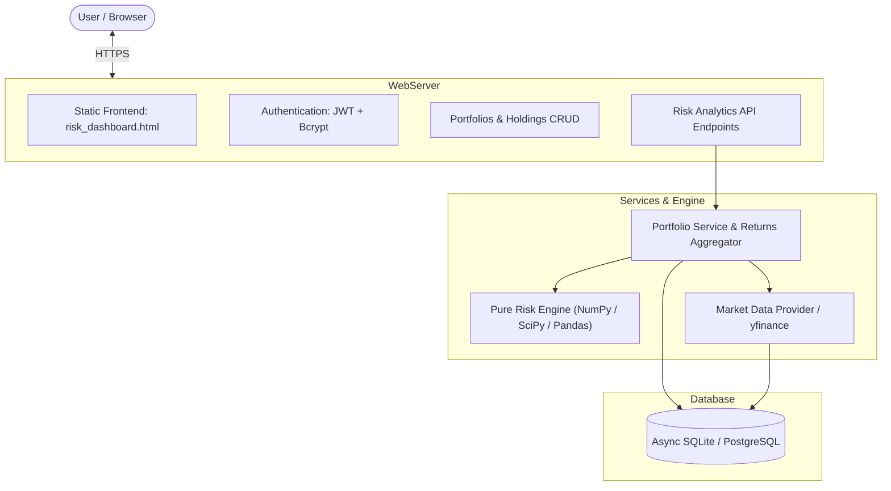

# ⚡ Vantage Risk — Quantitative Portfolio Risk Analytics Engine

<p align="center">
  
  
  
  
  
  <a href="https://vantage-risk-0xag.onrender.com" target="_blank">
    
  </a>
</p>

---

## 📌 Overview

**Vantage Risk** is a modern, high-performance quantitative portfolio risk analytics platform. Engineered for portfolio managers, quantitative analysts, and financial engineers, it pairs a pure mathematical risk calculation engine with an asynchronous FastAPI backend and a dark-mode interactive terminal dashboard.

It connects real-world equity data streams with institutional-grade risk calculations: from parametric & historical Value-at-Risk (VaR) to Euler marginal risk decomposition, maximum drawdown recovery cycles, and dynamic asset correlation matrices.

* **🌐 Live Production Web App:** [https://vantage-risk-0xag.onrender.com](https://vantage-risk-0xag.onrender.com)
* **📚 Interactive API Documentation (Swagger UI):** [https://vantage-risk-0xag.onrender.com/docs](https://vantage-risk-0xag.onrender.com/docs)
* **📖 Alternative API Specs (ReDoc):** [https://vantage-risk-0xag.onrender.com/redoc](https://vantage-risk-0xag.onrender.com/redoc)

---

## 🚀 Key Features

### 1. Pure Mathematical Risk Engine
- **Return & Performance Metrics:** Total Log/Simple Returns, Compound Annual Growth Rate (CAGR), Annualized Volatility, Sharpe Ratio, and Sortino Ratio.
- **Benchmark-Relative Analytics:** CAPM Beta, Jensen's Alpha ($\alpha$), Tracking Error, and Information Ratio against customizable benchmarks (e.g., `SPY`, `QQQ`).
- **Tail-Risk Analysis (VaR & CVaR):**
  - **Historical Simulation:** Percentile ranking on rolling multi-day log returns.
  - **Parametric Gaussian VaR & CVaR:** Closed-form analytic risk estimates using standard normal distributions via `scipy.stats`.
- **Drawdown Profiling:** High-water mark wealth index tracking, maximum peak-to-trough drawdown (MDD), drawdown duration (days), and recovery status.
- **Euler Risk Attribution (Component VaR / Volatility Decomposition):**
  - Calculates Marginal Contribution to Total Risk (**MCTR**) and Component Contribution to Total Risk (**CCTR**).
  - Verifies Euler's Theorem identity: $\sum_i \text{CCTR}_i = \sigma_p$.
- **Asset Interdependence:** Asset-level Pearson correlation matrix and annualized covariance matrix ($\Sigma \times 252$).
- **Rolling Windows:** 21-day and 63-day rolling volatility, rolling Sharpe ratio, and rolling beta series.

### 2. Market Data & Caching Pipeline
- Real-time equity data ingestion via `yfinance`.
- Local asynchronous caching layer using SQLAlchemy 2.0 with SQLite / PostgreSQL to avoid redundant API rate limits and minimize latency.
- Automatic log return computation: $r_t = \ln(P_t / P_{t-1})$.

### 3. Institutional Terminal UI
- Single-page application (SPA) with a sleek financial-terminal theme.
- Interactive quantitative charting powered by **Plotly.js** (Equity curves, underwater drawdown plots, correlation heatmaps, and risk attribution bar charts).
- Live portfolio configuration modal with real-time weight rebalancing validation.

### 4. Enterprise Security
- Stateless JWT-based authentication (`python-jose`).
- Password hashing with adaptive bcrypt rounds.
- Per-user portfolio isolation and multi-tenant database relationships.

---

## 🏛️ System Architecture



---

## 📐 Mathematical Formulas Implemented

| Metric | Mathematical Formulation |
| :--- | :--- |
| **Log Returns** | $r_t = \ln\left(\frac{P_t}{P_{t-1}}\right)$ |
| **CAGR** | $\text{CAGR} = (1 + R_{\text{total}})^{\frac{252}{N}} - 1$ |
| **Annualized Volatility** | $\sigma_{\text{ann}} = \sigma_{\text{daily}} \times \sqrt{252}$ |
| **Sharpe Ratio** | $\text{Sharpe} = \frac{\mu_{\text{ann}} - R_f}{\sigma_{\text{ann}}}$ |
| **Sortino Ratio** | $\text{Sortino} = \frac{\mu_{\text{ann}} - R_f}{\sqrt{\frac{1}{K}\sum \min(0, r_t)^2} \times \sqrt{252}}$ |
| **Beta ($\beta$)** | $\beta = \frac{\text{Cov}(r_p, r_b)}{\text{Var}(r_b)}$ |
| **Jensen's Alpha ($\alpha$)** | $\alpha = \mu_{p,\text{ann}} - \left(R_f + \beta \times (\mu_{b,\text{ann}} - R_f)\right)$ |
| **Parametric VaR ($1-\alpha$)** | $\text{VaR}_{1-\alpha} = -\left(\mu \cdot h + Z_{\alpha} \cdot \sigma \sqrt{h}\right)$ |
| **Euler MCTR** | $\text{MCTR}_i = \frac{(\Sigma w)_i}{\sigma_p}$ |
| **Euler CCTR** | $\text{CCTR}_i = w_i \times \text{MCTR}_i, \quad \text{where } \sum_i \text{CCTR}_i = \sigma_p$ |

---

## 🔌 API Endpoints Summary

### Authentication
* `POST /auth/register` — Register a new account.
* `POST /auth/token` — Exchange credentials for a JWT bearer token.
* `GET /auth/me` — Retrieve current authenticated user profile.

### Securities & Search
* `GET /securities/search?q={query}` — Search tickers and asset metadata.
* `GET /securities/{symbol}/prices` — Get historical price series for a symbol.

### Portfolios & Holdings
* `GET /portfolios/` — List all user portfolios.
* `POST /portfolios/` — Create a new portfolio (with default benchmark).
* `GET /portfolios/{id}` — Get portfolio details with holdings.
* `PUT /portfolios/{id}` — Update portfolio metadata.
* `DELETE /portfolios/{id}` — Delete a portfolio.
* `POST /portfolios/{id}/holdings` — Add or rebalance holdings (auto-validates weights).

### Quantitative Analytics
* `GET /portfolios/{id}/performance` — Return CAGR, Sharpe, Sortino, Alpha, Beta, Tracking Error.
* `GET /portfolios/{id}/risk` — Historical VaR/CVaR, Parametric VaR/CVaR, Max Drawdown.
* `GET /portfolios/{id}/risk-contribution` — Euler risk decomposition (MCTR, CCTR, % risk).
* `GET /portfolios/{id}/correlation` — Correlation and annualized covariance matrices.
* `GET /portfolios/{id}/rolling` — Rolling 21-day volatility, Sharpe, and beta time series.
* `GET /portfolios/{id}/equity-curve` — Rebased wealth index & drawdown curve vs. benchmark.

---

## 🛠️ Local Development & Setup

### Prerequisites
* Python 3.11 or higher
* `pip` and `virtualenv` / `venv`
* Git

### 1. Clone the Repository
```bash
git clone https://github.com/aakib10101/vantage-risk.git
cd vantage-risk
```

### 2. Create and Activate Virtual Environment
```bash
# macOS/Linux:
python3 -m venv .venv
source .venv/bin/activate

# Windows (PowerShell):
python -m venv .venv
.venv\Scripts\Activate.ps1
```

### 3. Install Dependencies
```bash
pip install --upgrade pip
pip install -r requirements.txt
```

### 4. Environment Configuration
Create a `.env` file in the root directory:
```env
SECRET_KEY=your-super-secret-random-key-here
ACCESS_TOKEN_EXPIRE_MINUTES=1440
DATABASE_URL=sqlite+aiosqlite:///./vantage_risk.db
```

### 5. Run the Application
```bash
uvicorn app.main:app --host 127.0.0.1 --port 8000 --reload
```

Once started:
* Dashboard UI: **http://127.0.0.1:8000**
* Interactive API Docs: **http://127.0.0.1:8000/docs**

---

## 🧪 Running Tests

The test suite validates risk calculations, Euler decomposition invariants, API contracts, and authentication:

```bash
pytest
```

---

## ☁️ Deployment

### Render (`render.yaml`)
This repository includes a native `render.yaml` configuration for seamless deployment on Render:

1. Connect your GitHub repository to Render.
2. Create a new **Web Service**.
3. Set the following parameters:
   - **Environment:** `Python`
   - **Build Command:** `pip install -r requirements.txt`
   - **Start Command:** `uvicorn app.main:app --host 0.0.0.0 --port $PORT`
4. Add environment variables:
   - `SECRET_KEY`: *(Auto-generated random string)*
   - `ACCESS_TOKEN_EXPIRE_MINUTES`: `1440`

---

## 📄 License

Distributed under the MIT License. See `LICENSE` for more information.
